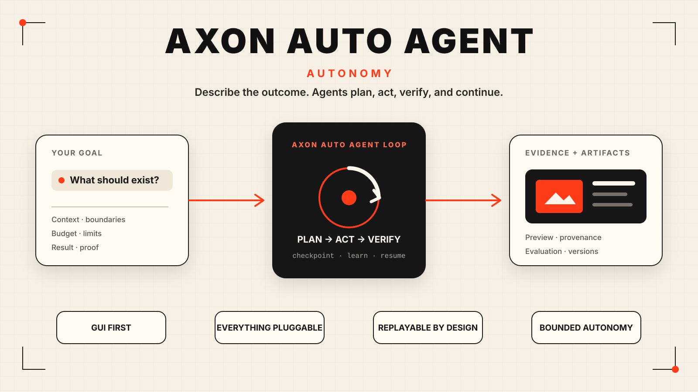
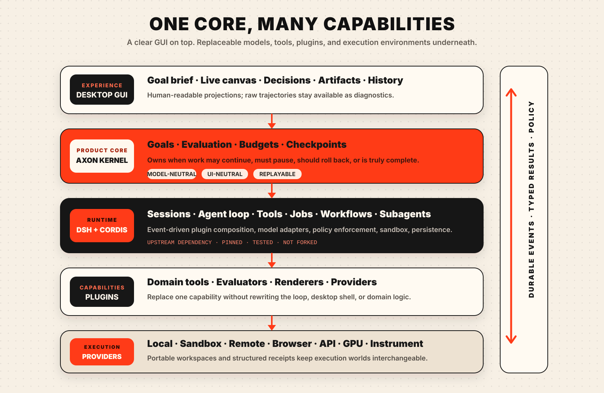

# Axon Auto Agent

[English](README.md) · [简体中文](README.zh-CN.md)



> **Give it a goal. It builds the path.**

Axon Auto Agent is an open-source desktop for autonomous work.

You describe what you want to accomplish. Axon turns that goal into a long-running
process that can investigate, use tools, create files, run experiments, check its own
work, recover from failure, and return with evidence—not just an answer.

This is not another chat box with more buttons. It is a bet on what software becomes
when models can handle increasingly complex work: the user states the outcome, while
the system figures out how to get there.

Axon is built on
[DeepSeek Harness](https://github.com/deepseek-ai/deepseek-harness), whose plugin
architecture makes the model, tools, sandbox, memory, workflows, and interface
replaceable. It also takes a core lesson from
[Karpathy's autoresearch](https://github.com/karpathy/autoresearch): real autonomy
needs a loop that can make a change, measure the result, keep what works, discard what
does not, and continue without constant supervision.

## The idea

Models are advancing faster than the applications around them.

Today, a frontier model may be capable of doing hours of useful work, but most products
still force it through a conversation designed for short answers. The model forgets
where it was, tools run in fragile environments, results are hard to verify, and the
user has to babysit every step.

The next important layer is not a bigger prompt. It is a reliable environment for
models to pursue goals over time.

Axon is building that environment.

## What it should feel like

The product begins with a simple desktop experience:

- Tell Axon the result you want, in ordinary language.
- Add the files, websites, data, repositories, or tools it may use.
- Watch meaningful progress instead of raw model noise.
- Preview documents, code, datasets, charts, images, and other outputs in the app.
- Routine work proceeds autonomously; confirmation appears only when a configured
  boundary would be crossed.
- Close the window and come back later without losing the task.
- Inspect the evidence behind the result and rewind to any important checkpoint.

The complexity belongs in the system, not on the user's screen.

## The autonomy loop

```text
Goal
  ↓
Understand → Plan → Act → Observe → Verify
               ↑                    ↓
               └── learn / retry / checkpoint
                                    ↓
                           result + evidence
```

Verification is the difference between an autonomous system and an endless agent loop.

For code, verification may be tests and benchmarks. For research, it may be source
quality, reproducible analysis, simulation, or an external experiment. For documents,
it may be factual support, structural checks, and visual inspection. For real-world
operations, it may be a receipt from the system that actually performed the action.

The model does not get to declare victory merely because its answer sounds convincing.

## Architecture



Axon separates the system into five layers:

1. **Desktop GUI** — goals, progress, decisions, artifacts, history, and diagnostics.
2. **Axon autonomy kernel** — evaluation, budgets, checkpoints, recovery, and the logic
   that decides whether work should continue.
3. **DeepSeek Harness** — sessions, agent execution, tools, jobs, workflows, subagents,
   model adapters, policy enforcement, and sandboxing.
4. **Plugins** — research methods, business skills, evaluators, artifact viewers, and
   integrations with external systems.
5. **Execution environments** — the local computer, containers, browsers, remote
   machines, cloud GPUs, APIs, and eventually scientific or physical instruments.

Axon extends DeepSeek Harness through its public plugin system instead of maintaining a
private fork. The goal is simple: replace any model, tool, evaluator, or execution
environment without rebuilding the product around it.

Read the [architecture notes](docs/ARCHITECTURE.md) for the technical boundaries.

## From research to almost anything

The same foundation can support very different kinds of work:

- **Research** — read literature, propose hypotheses, write code, run simulations,
  compare results, and assemble evidence.
- **Engineering** — understand a repository, make changes, run tests and benchmarks,
  inspect failures, and keep only verified improvements.
- **Knowledge work** — turn files and data into reports, presentations, spreadsheets,
  websites, or other finished deliverables.
- **Operations** — work across browsers and APIs, monitor long-running processes, and
  verify that an external action actually happened.
- **Creative production** — coordinate models, tools, references, compute, review, and
  final assets through one persistent task.

Every domain needs different plugins and different ways to judge success. The autonomy
loop should not need to be rewritten for each one.

## Where it starts

The repository is currently the foundation: the product direction, GUI principles,
architecture, community rules, and implementation boundaries are in place. There is no
runnable release yet.

The first public milestone is deliberately focused: a desktop application that can run
one bounded goal, show its work clearly, explain the risk before crossing a configured
boundary, produce a real artifact, and recover the same task after the application restarts.

After that, the project expands through better evaluators, richer artifacts, remote
execution, more models, more plugins, and multiple cooperating agents.

See the [roadmap](docs/ROADMAP.md) and [GUI principles](docs/GUI-PRINCIPLES.md).

## The hard problems are the project

Long-running autonomy is not solved by adding “continue” to a prompt.

The serious problems are durable state, evaluator quality, reward hacking, safe tool
use, reproducible research, cost control, recovery after partial failure, cross-machine
execution, plugin trust, and building system boundaries that high-risk actions cannot bypass.

Some of these problems will become easier as models improve. Others are systems
problems that have to be engineered directly. Axon exists to work on both.

## Join us

If you are interested in agent runtimes, desktop interaction, sandboxing, evaluation,
scientific automation, artifact rendering, long-running systems, or how intelligent
software can act reliably in the real world, there is room to shape the foundation.

Start with [Contributing](CONTRIBUTING.md), [Security](SECURITY.md), and
[Third-party projects](THIRD_PARTY.md).

Axon Auto Agent is licensed under [Apache-2.0](LICENSE).
