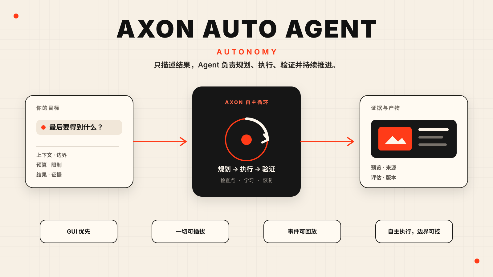
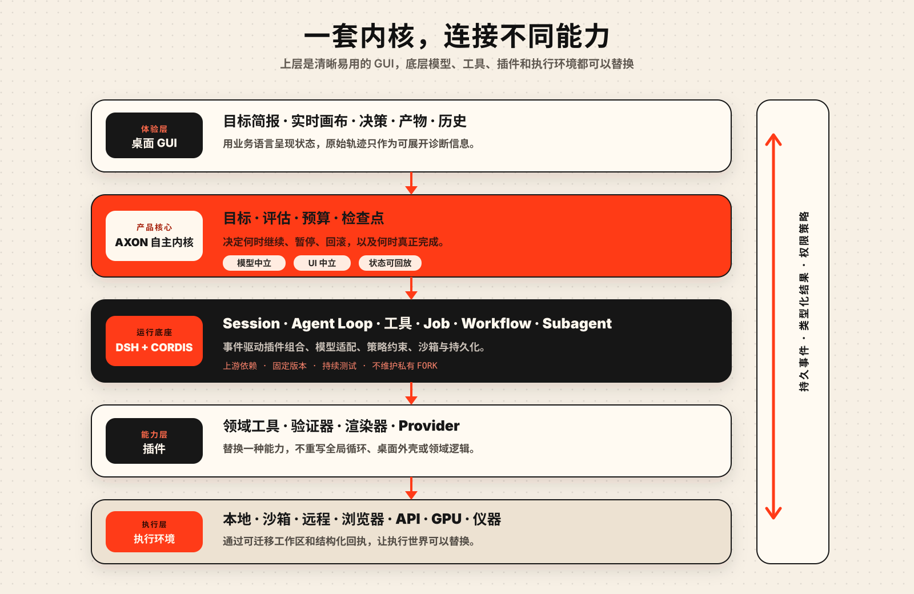

# Axon Auto Agent

[English](README.md) · [简体中文](README.zh-CN.md)



> **给它一个目标，剩下的路，让它自己走完。**

Axon Auto Agent 是一个为自主任务而生的开源桌面应用。

你只需要描述想完成什么。Axon Auto Agent 会把目标变成一个可以长期运行的任务：
查资料、调用工具、处理文件、编写代码、运行实验、检查结果、从失败中恢复，最后带着产物和证据
回来，而不只是生成一段看上去正确的回答。

这不是给聊天框多加几个按钮。它押注的是模型能力继续增长之后的软件形态：用户负责说清楚
结果，系统负责找到通往结果的路径。

Axon Auto Agent 基于 [DeepSeek Harness](https://github.com/deepseek-ai/deepseek-harness) 构建。
它的插件架构让模型、工具、沙箱、记忆、Workflow 和界面都可以被替换。项目也吸收了
[Karpathy 的 autoresearch](https://github.com/karpathy/autoresearch) 最重要的思想：
真正的自主执行必须能够做出改变、测量结果、保留有效改进、丢弃失败尝试，并在没有人持续
盯着的情况下继续前进。

## 核心想法

模型的进步速度已经超过包裹它们的软件。

今天的前沿模型可能已经能够完成数小时的有价值工作，但大多数产品仍然把它塞进一个只适合
短回答的对话框。任务进行到一半就丢失状态，工具运行在脆弱的环境里，结果无法验证，用户还
得守在旁边不停点击“继续”。

下一层真正重要的基础设施，不是更长的提示词，而是一个能让模型长期追逐目标的可靠环境。

Axon Auto Agent 要做的就是这个环境。

## 它应该是什么体验

产品从一个足够简单的桌面端开始：

- 用正常语言告诉 Axon Auto Agent 最后想得到什么。
- 把允许使用的文件、网站、数据、代码仓库或工具交给它。
- 看到真正有意义的进展，而不是满屏模型日志。
- 在应用里直接预览文档、代码、数据集、图表、图片和其他产物。
- 普通任务默认自主推进，只有越过预设边界时才请求确认。
- 关掉窗口，过一段时间回来，任务仍然在那里继续。
- 查看结果背后的证据，也能回到任何重要检查点重新开始。

复杂性应该留在系统内部，而不是扔到用户脸上。

## 自主循环

```text
目标
 ↓
理解 → 规划 → 执行 → 观察 → 验证
          ↑                 ↓
          └── 学习 / 重试 / 检查点
                             ↓
                         结果 + 证据
```

有没有验证，是自主系统和无限循环 Agent 的真正分界线。

写代码可以用测试和 Benchmark 验证；做研究可以检查来源质量、可复现分析、仿真或外部实验；
生成文档可以检查事实依据、结构和视觉质量；操作真实系统则需要拿到那个系统返回的可靠回执。

模型不能因为自己说得很有道理，就宣布任务已经完成。

## 架构



Axon Auto Agent 把系统拆成五层：

1. **桌面 GUI** —— 目标、进展、决策、产物、历史和诊断。
2. **Axon Auto Agent 自主内核** —— 验证、预算、检查点、故障恢复，以及决定任务是否应该
   继续的逻辑。
3. **DeepSeek Harness** —— Session、Agent 执行、工具、Job、Workflow、Subagent、模型适配、
   策略约束和沙箱。
4. **插件** —— 科研方法、业务能力、验证器、产物预览和外部系统集成。
5. **执行环境** —— 本地电脑、容器、浏览器、远程主机、云端 GPU、API，以及未来的科研和
   物理设备。

Axon Auto Agent 通过 DeepSeek Harness 公开的插件系统扩展能力，而不是维护一个私有 Fork。
目标很直接：更换模型、工具、验证器或执行环境时，不需要把整个产品重新做一遍。

技术边界详见[架构说明](docs/ARCHITECTURE.md)。

## 从科研走向几乎一切

同一套底层可以承载完全不同的工作：

- **科研** —— 阅读论文、提出假设、编写代码、运行仿真、比较结果并组织证据。
- **工程** —— 理解代码仓库、做出修改、运行测试和 Benchmark、分析失败，只保留经过验证的改进。
- **知识工作** —— 把文件和数据变成报告、PPT、表格、网站或其他真正完成的交付物。
- **运营工作** —— 操作浏览器和 API、监控长任务，并确认外部动作是否真的发生。
- **创意生产** —— 统一协调模型、工具、参考素材、算力、审查和最终资产。

不同领域需要不同插件，也需要不同的成功判断方式，但不应该为每个领域重写一套自主循环。

## 从哪里开始

当前仓库完成的是地基：产品方向、GUI 原则、技术架构、社区规范和实现边界。现在还没有可运行
版本。

第一个公开里程碑会非常聚焦：做出一个桌面应用，能够执行一个边界明确的目标，清楚展示自己
正在做什么，在越过预设边界前清楚说明风险，生成一个真实产物，并在应用重启后恢复同一个任务。

之后再逐步加入更强的验证器、更丰富的产物、远程执行、更多模型、更多插件和多 Agent 协作。

详见[路线图](docs/ROADMAP.md)和 [GUI 原则](docs/GUI-PRINCIPLES.md)。

## 真正的难题就是项目本身

长期自主执行不是在提示词结尾加一句“永远不要停止”。

真正困难的是持久状态、验证器质量、奖励投机、安全调用工具、科研可复现、成本控制、局部失败
后的恢复、跨机器执行、插件可信度，以及如何为高风险行为建立不可绕过的系统边界。

其中一些问题会随着模型变强而减轻，另一些是必须直接解决的系统工程问题。
Axon Auto Agent 同时面向这两类问题。

## 加入我们

如果你关注 Agent Runtime、桌面交互、沙箱、结果验证、科研自动化、产物渲染、长任务系统，
或者智能软件如何在真实世界里可靠行动，现在正是参与底层设计的时候。

请先阅读[贡献指南](CONTRIBUTING.md)、[安全说明](SECURITY.md)和
[第三方项目说明](THIRD_PARTY.md)。

Axon Auto Agent 使用 [Apache-2.0](LICENSE) 许可。
